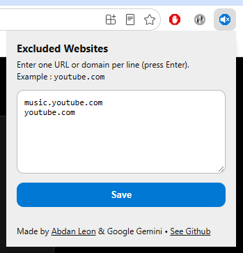

## Get the Files
- You can download the .zip file from this GitHub repository or the provided <a href="https://drive.google.com/file/d/10mL8PYLXjXeGyzrkxkVgZo5Z4EPKIvmC/view">Google Drive</a> link.
- Extract the .zip archive and place it in a safe location, such as Downloads, Documents, or Local Disk.
- Once extracted, open the resulting easy-mute-tab folder and verify that it contains: icons (folder), background.js, manifest.json, popup.html, and popup.js.

## Install the Extension
- Open your browser and go to the Extensions page.
- Enable Developer Mode and click Load Unpacked.
- Select the easy-mute-tab folder and confirm.

## Compatible Browsers
| Browser | Extension Link |
| --- | --- |
| Google Chrome | `chrome://extensions/` |
| Microsoft Edge | `edge://extensions/` |
| Brave | `brave://extensions/` |
| Opera | `opera://extensions/` |
| Vivaldi | `vivaldi://extensions/` |

## How to Configure Exclusions
- Click the Easy Mute Tab extension icon.
- Enter the websites you want to exclude (keep unmuted).
- Click Save and restart your browser.

## Remove the Extension
- Open your browser and go to the Extensions page.
- Find the Easy Mute Tab extension and click Remove.
- If needed, delete the easy-mute-tab folder from your PC or laptop.
